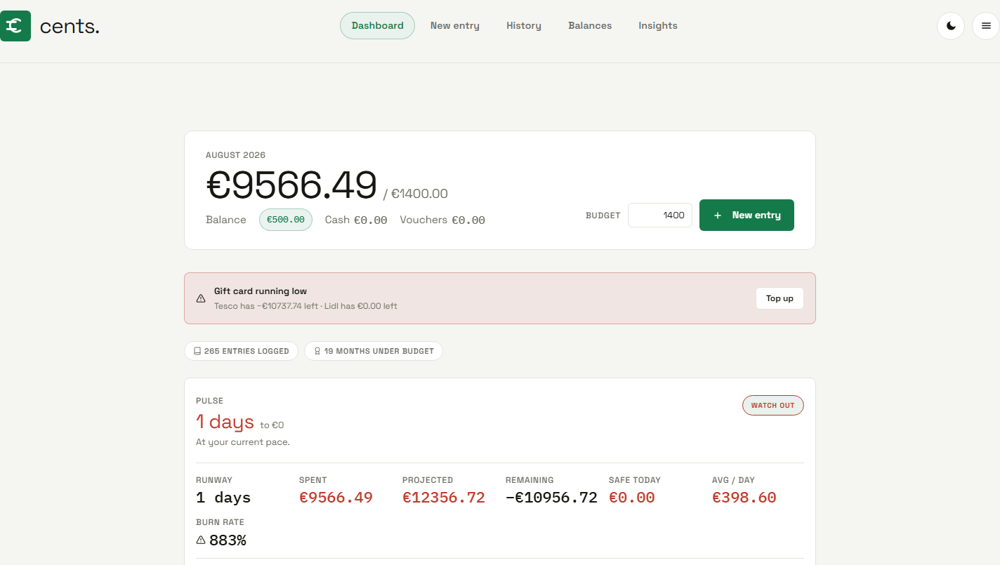

# cents.

A calm, private expense tracker that runs in your browser — no app store, no account, no sign-up.

**Live:** https://cents-app.pages.dev

## What it does

- **Log an expense by typing** — `lidl groceries 4.47 revolut` — and the app works out the amount, category and payment method.
- **Budget** — a monthly target, what is left, and a safe-to-spend-today figure.
- **Balances** — bank accounts and gift cards, with transfers, split payments and payment methods you add yourself.
- **Bills** — recurring rent, subscriptions and paydays, each marked done in one tap.
- **Undo anything**, even after a reload.
- **Your data is yours** — JSON and CSV export, a merge-restore that cannot lose entries, and recovery for a document the browser could not parse.
- **Installable** — a home-screen app with launcher shortcuts, share-into-the-app quick entry, and fingerprint or Face ID unlock.
- **Tesco Pay** — log shifts by quick entry, roster photo or workbook import, with paid hours, Sunday pay, an Irish PAYE/USC/PRSI estimate and pay tracked per week.
- **Light or dark** — the app opens light; the choice is remembered on the device.
- **Optional sync** — off by default, so nothing leaves the browser unless you turn it on.
- **Profiles** — one deployment, an account per person, each with its own entries, optional PIN and tab access.

## How it works

Everything lives on the device by default. Turning sync on keeps that account's document in the deployment's KV store and mirrors it to a private GitHub repo you control, with the two compared after every save. A service worker keeps the app working offline.

## Built with

Hand-written HTML, CSS and ES modules — no framework, no build step — in one Cloudflare Pages project with its functions and a KV namespace.

## Notes for developers

The design decisions, the deployment and the guard suite are written down in [`CLAUDE.md`](CLAUDE.md). Two checks stay hand-run rather than in CI: `scripts/pin-screens.browser.mjs`, which drives the lock and every screen under the production CSP, and `a11y-harness.html`, which audits every route and menu surface in a real browser.
