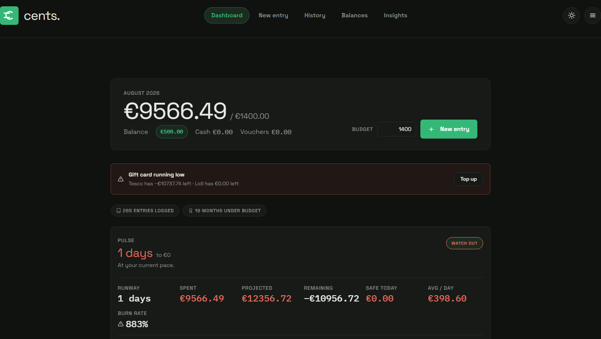
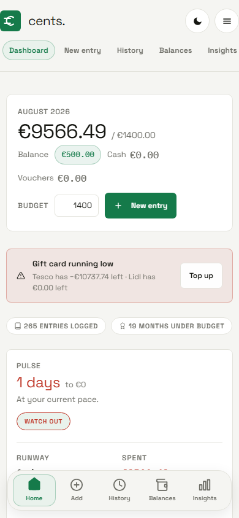
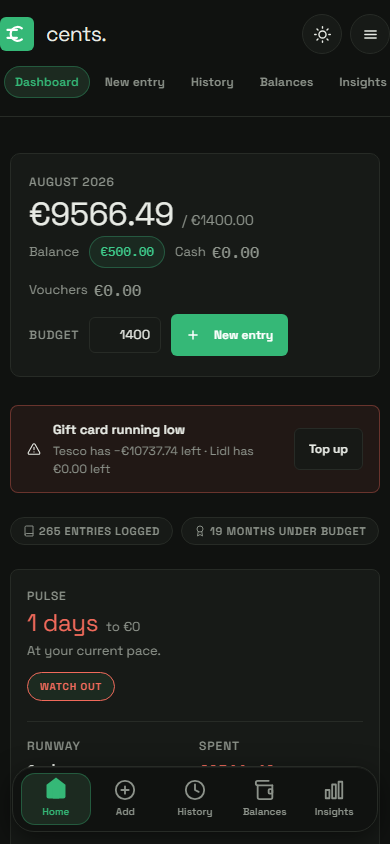

# cents. — a calm personal expense tracker

**cents.** is a clean, fast expense tracker that runs entirely in your browser — no app store, no account, no data uploaded anywhere (unless you turn on sync). You log what you spend, set a monthly budget, and the app shows you exactly where you stand: how much you've spent, what's safe to spend today, and where the money goes.


## What it looks like

Light and dark mode, on desktop and mobile.

| Desktop · light | Desktop · dark |
| --- | --- |
|  |  |

| Mobile · light | Mobile · dark |
| --- | --- |
|  |  |

## What you can do

- **Log expenses your way** — type plain English like `lidl groceries 4.47 revolut` and the app figures out the amount, category, payment method, and date for you. Review it, tweak it, save it.
- **Keep a budget** — set a monthly target and see your spend at a glance: remaining, projected, and a "safe to spend today" number.
- **Know your balances** — track bank accounts (AIB, Revolut) and gift cards (Tesco, Lidl, Aldi), reconcile them against real statements, and top up a card without faking a transaction.
- **Never miss a bill** — add recurring items (rent, subscriptions, paydays) and see what's due next, with one-tap marking.
- **Undo anything** — every action can be undone, even after a reload.
- **Keep it private** — the app boots locked (default PIN `100901`); on your phone you can unlock with fingerprint or Face ID instead.

## Getting started

1. **Open the app** — run it locally (see below) or open your deployed version.
2. **Unlock** — the default PIN is `100901`. Set your own in **☰ → Privacy & security**.
3. **Set your budget** — the monthly budget box is right on the dashboard.
4. **Log something** — hit **Add** and type something like `coffee 3.50`.

That's it. Everything is saved to your browser automatically.

## Privacy & sync

- **By default, everything stays on your device.** Your data lives in your browser's local storage. Nothing is sent anywhere.
- **Optional cloud sync** — if you want the same data on your phone and laptop, sync keeps a copy of your data in a **private GitHub repo you control**. The app talks to your repo through a small Netlify function; your GitHub token never touches the browser. Set it up in **☰ → Cloud sync**.
- **Your data is yours** — you can export everything as a JSON file (☰ → Data) at any time.

## Running it yourself

The app needs a tiny local web server (browsers block the file directly):

```bash
./serve.sh              # then open http://localhost:8080
# or, on any OS:
python -m http.server 8080
```

Everything works locally except cloud sync, which needs the deployed Netlify function.

## For developers

A single-page app — **no build step, no framework, no dependencies to install**. Just HTML, ES modules, and hand-written CSS.

```
index.html         shell + boot scripts
app.js             the whole UI: routing, screens, modals, undo, lock
styles.css         design system (monochrome + emerald)
storage.js         data: load/save/validate, undo journal
settings.js        device settings (sync, PIN, biometrics)
sync.js            cloud-sync client
sync-merge.js      merge logic for syncing two devices
seed.js            defaults: categories, methods, settings
netlify/           serverless functions (GitHub sync proxy, setup links)
sw.js              service worker (offline support)
```

- **Data model** — one JSON document: `entries` (transactions), `settings` (budget, categories, balances), `schemaVersion`. Validated on every load; a hand-edited file can never crash the app.
- **Sync** — union merge (entries by id, newest wins; deletions become tombstones; conflicts auto-resolve). See `CLAUDE.md` for the full conventions and security invariants.
- **Changing categories or methods?** Edit `CATEGORIES`/`METHODS` in `seed.js` *and* the matching `*_OK` sets in `storage.js`.
- **Testing** — no test framework; verify with `node --check` per file and manual testing in the browser.

## License

Personal project — do whatever you like with it.
